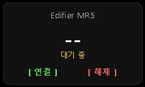
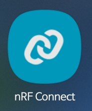
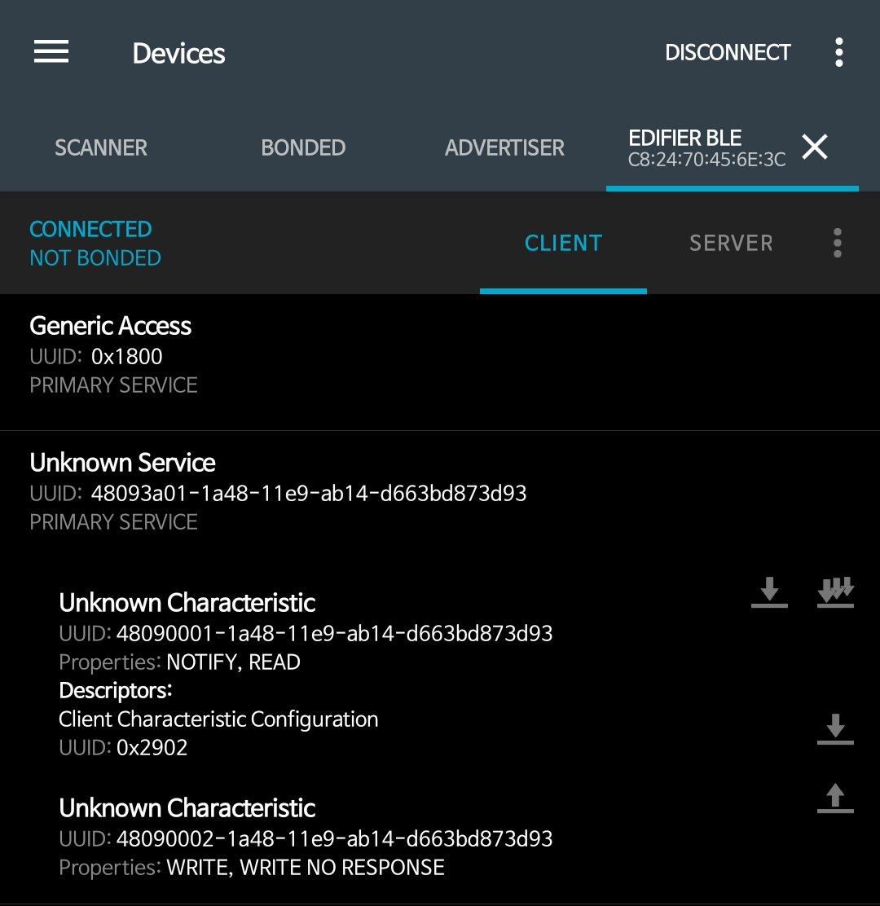
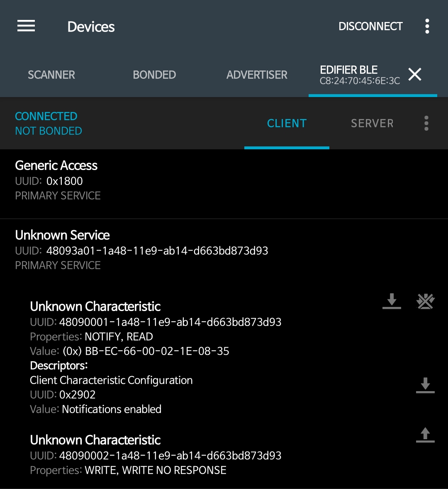

# 🔊 Edifier MR5 BLE Volume OSD & Rainmeter Widget

데스크탑 환경에서 **Edifier MR5** 스피커를 3.5mm(AUX) 단자로 사용할 때, 기기의 볼륨 노브를 돌리면 화면에 즉각적으로 볼륨 정보가 표시되도록 만든 파이썬(Python) 및 레인미터(Rainmeter) 연동 프로젝트입니다.

스마트폰 전용 앱을 켜지 않아도 PC 화면에서 스피커의 현재 볼륨과 연결 상태를 직관적으로 확인할 수 있습니다!

<div align="center">
&nbsp;&nbsp;&nbsp;
<br/>
스킨 이미지(좌: MR5 연결 전 스킨, 우: MR5 연결 후 스킨)
<br/><br/>
<br/>
OSD Overlay UI 디자인
</div>

## ✨ 주요 기능 (Features)
* **실시간 OSD 오버레이:** 볼륨 조절 시 윈도우 중앙 하단에 부드럽고 투명한 커스텀 OSD 창이 즉각적으로 나타났다 사라집니다.
* **레인미터(Rainmeter) 연동:** 바탕화면의 레인미터 스킨에 현재 볼륨과 블루투스 연결 상태, 에러 메시지 등이 실시간으로 동기화됩니다.
* **설정 저장 (Auto-save):** 마지막으로 설정한 볼륨값을 기억하여 프로그램을 다시 켜도 이전 볼륨을 화면에 띄워줍니다.
* **독립적인 설정 관리 (`config.ini`):** 소스 코드를 직접 수정할 필요 없이 설정 파일에 MAC 주소와 UUID만 적으면 누구나 사용할 수 있습니다.
* **완벽한 프로세스 제어 (Kill Switch):** 레인미터의 [해제] 버튼을 누르면 좀비 프로세스 없이 깔끔하게 모든 백그라운드 작업이 종료됩니다.

## 🛠️ 요구 사항 (Prerequisites)
* **OS:** Windows 10 또는 Windows 11 (x64)
* **Hardware:** Bluetooth 통신이 가능한 데스크탑 또는 노트북 (동글 가능)
* **Software:** [Rainmeter](https://www.rainmeter.net/). Python과 BLE 라이브러리는 스킨에 포함되어 있습니다.

## 📦 설치 및 설정 (Installation & Setup)

### 1. MAC 주소 및 UUID 찾기
에디파이어 MR5의 BLE(Bluetooth Low Energy) 통신용 MAC 주소와 볼륨 Notify UUID를 알아야 합니다.

(안드로이드 스마트폰 기준)

&nbsp;&nbsp;&nbsp;&nbsp;<br />

1. 스마트폰에 nRF Connect for Mobile 앱을 설치하고 기기를 스캔합니다.


&nbsp;&nbsp;&nbsp;&nbsp;<br />
 
2. `EDIFIER BLE` 라는 이름을 갖는 장치를 찾아서 CONNECT 버튼을 누릅니다. 이때 장치 이름 바로 아래에 보이는 16진수가 `MAC 주소`입니다.

&nbsp;&nbsp;&nbsp;&nbsp;<br />

3. 그럼 위 이미지와 같은 화면으로 전환이 됩니다. 여기서 `Unknown Service` 항목을 누르면 이미지 처럼 `Unknown Characteristic` 라는 세부 항목이 출력됩니다.

&nbsp;&nbsp;&nbsp;&nbsp;<br />

4. 저 항목 중 사진과 같은 아이콘 버튼을 누른 후 MR5 장치의 노브를 돌려봅니다.

&nbsp;&nbsp;&nbsp;&nbsp;<br />

5. 해당 항목의 `Value:`부분 값이 변경되면 볼륨을 확인할 수 있는 `Notify UUID`입니다.

<br />

### 2. 레인미터 스킨 설치
1. [Rainmeter](https://www.rainmeter.net/) 최신 버전으로 설치합니다.
2. [레인미터 스킨 최신버전](https://github.com/fms2014-github/edifier-MR5-volume-indicator/releases)을 다운받습니다.
3. 다운받은 .rmskin을 실행합니다.
4. 폴더로 설치하거나 다른 PC로 복사할 때는 `EdifierMR5` 폴더 전체를 복사합니다. 스킨은 `@Resources\MR5Service\MR5Service.exe`를 실행하며, 같은 폴더의 `_internal`에서 런타임을 불러옵니다.

### 3. Config.ini 설정
`@Resources/config.ini` 파일을 열고 본인 기기의 정보로 수정합니다.

```ini
[Device]
MAC_ADDRESS = A1:B2:C3:D4:E5:F6
VOLUME_UUID = 0000xxxx-0000-1000-8000-00805f9b34fb

[Variables]
AUTO_CONNECT=Y
```
### 🚀 사용 방법 (Usage)
1. 바탕화면 우측 하단의 레인미터 아이콘을 우클릭하고 **전체 새로고침(Refresh all)** 을 누릅니다.

2. 레인미터 관리자에서 `EdifierMR5` 스킨을 찾아 **불러오기(Load)** 합니다.

3. `AUTO_CONNECT=Y`이면 스킨을 불러오거나 새로고침할 때 MR5 연결을 한 번 시도합니다. `AUTO_CONNECT=N`이면 대기합니다. 어느 설정에서든 **[ 연결 ]** 버튼으로 직접 연결할 수 있습니다.

4. 상태가 `연결됨`으로 변경되면, MR5 스피커의 볼륨 노브를 돌려보세요!

5. 사용을 중지하려면 **[ 해제 ]** 버튼을 누르면 완벽하게 종료됩니다.

### 🚨 문제 해결 (Troubleshooting)
* `오류: config.ini 파일이 없습니다` / 양식이 잘못되었습니다: @Resources 폴더 안에 config.ini 파일이 올바르게 존재하는지, 주소 형식이 맞는지 확인하세요.

* `오류: 기기를 찾을 수 없습니다`는 다음 경우 중 하나 입니다.
   *  스피커의 전원이 OFF상태
   *  스피커와 PC의 블루투스 안테나와 거리가 너무 멂
   *  스피커가 스마트폰이나 PC 중 하나와 블루투스 페어링이 이루어져 있지 않는 상태

* 볼륨이 튀거나 이상한 값이 나옴: 코드는 데이터 패킷의 세 번째 바이트가 `102(0x66)`인 경우만 볼륨으로 인식하도록 필터링되어 있습니다. 펌웨어 버전에 따라 패킷 구조가 다를 수 있으니 파이썬 코드의 volume_notification_handler 부분을 디버깅해 보세요.

* `[ 해제 ]`를 누르면 서비스가 `@Resources\stop.txt`를 감지하고 종료됩니다. 다시 연결할 때 서비스가 이 파일을 지웁니다.

* 해당 스킨을 사용해 블루투스 BLE와 연결하면 스마트폰의 `Edifier ConneX` 앱과 연결이 안 될 수 있습니다. 앱으로 스피커 설정이 필요할 경우 스킨의 `[ 해제 ]` 버튼을 누르세요.

### 서비스 다시 빌드하기 (개발용)

`dev`에는 Python 소스, README 이미지, 빌드용 라이선스가 있습니다. 서비스를 다시 빌드할 때는 먼저 Rainmeter에서 MR5 스킨을 언로드한 뒤, 스킨 폴더에서 다음 명령을 실행합니다. 가상 환경과 중간 산출물은 임시 폴더에 두고 완성된 서비스만 `@Resources\MR5Service`에 저장합니다.

```powershell
$build = Join-Path $env:TEMP "EdifierMR5-build"
py -3.13 -m venv "$build\venv"
& "$build\venv\Scripts\python.exe" -m pip install "PyInstaller==6.22.3" "bleak==2.1.1" "winrt-runtime==3.2.1"
& "$build\venv\Scripts\python.exe" -m PyInstaller --noconfirm --workpath "$build\work" --distpath "@Resources" MR5Service.spec
```

### 배포용 .rmskin 만들기

**Rainmeter 공식 패키저**를 쓰려면 스킨 폴더에서 아래 명령으로 배포용 폴더를 준비합니다. 스킨이나 서비스가 바뀌면 같은 명령으로 갱신합니다.

```powershell
py -3.13 package_skin.py --prepare
```

이 명령은 `Skins`와 같은 위치에 있는 `Deploy\EdifierMR5` 폴더를 갱신합니다. Rainmeter 관리에서 **.rmskin 패키지 만들기 → 스킨 추가 → 사용자 지정 폴더**를 선택한 뒤, `Rainmeter\Deploy\EdifierMR5`를 지정합니다. 이 폴더에는 위젯, 서비스와 런타임, 라이선스, 장치 정보를 비워 둔 `config.ini`가 들어갑니다. 설치 직후 스킨을 불러오려면 다음 화면에서 `EdifierMR5\MR5_Overlay.ini`를 선택합니다.

설치된 스킨 폴더를 직접 선택하면 현재 장치 설정과 볼륨 기록도 패키지에 들어갈 수 있습니다. 공식 패키저는 Windows 숨김 폴더를 건너뜁니다. Git에서 새로 받은 작업 사본을 직접 패키징할 때는 스킨 폴더에서 `attrib +h dev`를 실행해 개발 자료를 제외합니다.

스크립트로 같은 구성의 패키지를 바로 만들 수도 있습니다.

```powershell
py -3.13 package_skin.py "$env:USERPROFILE\Downloads\EdifierMR5-x64.rmskin"
```

설치한 뒤 오른쪽 위 톱니바퀴로 MAC 주소와 볼륨 UUID를 입력합니다. 기존 스킨에 덮어 설치하려면 먼저 `@Resources\config.ini`를 따로 보관해 두세요.

### 📝 라이선스
MIT License
